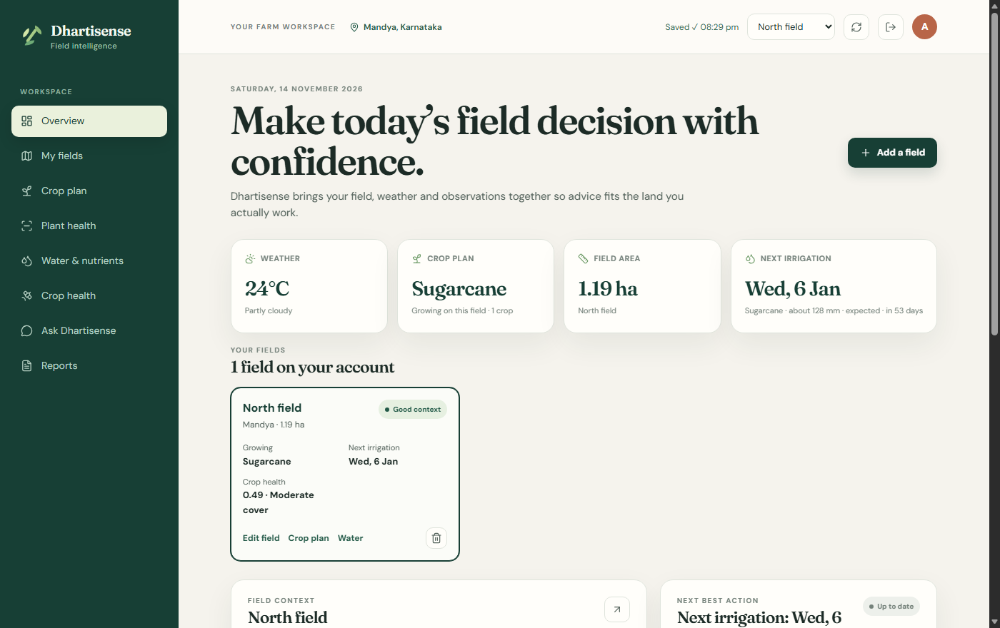
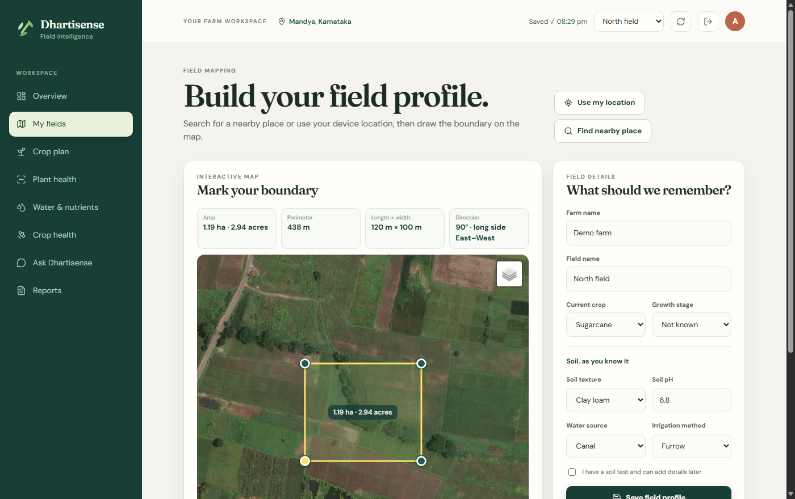
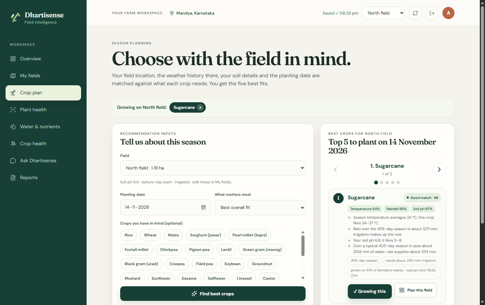
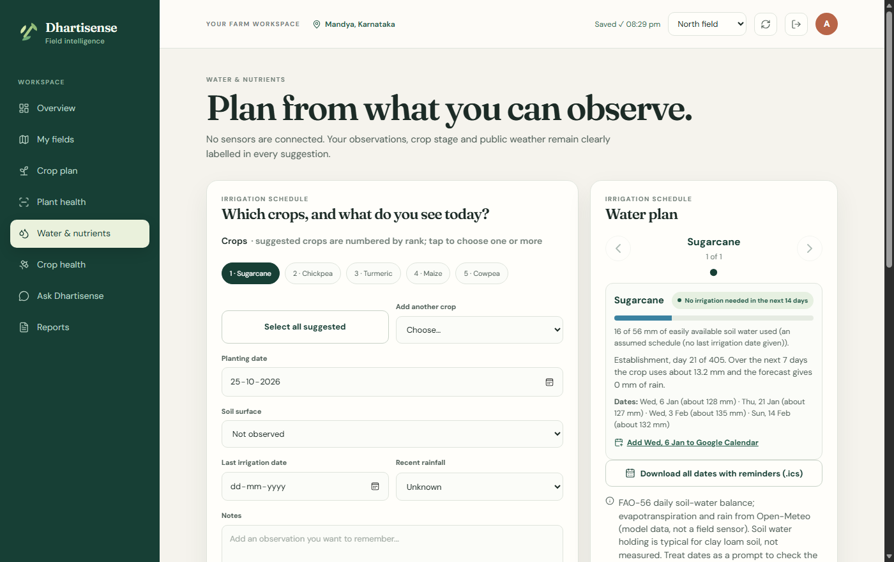
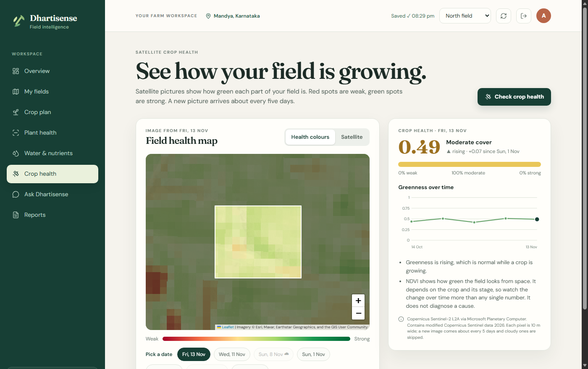
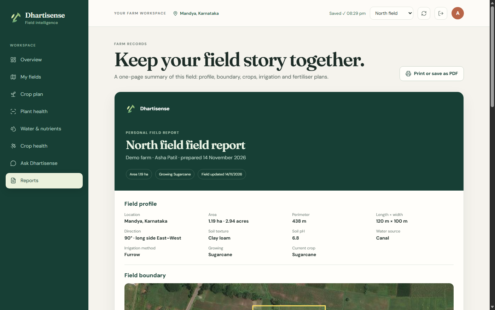

# Dhartisense

**Free, field-aware advice for small farmers: map a field, then get crop suggestions, irrigation dates, fertiliser plans and satellite crop-health readings for it.**

[](LICENSE)


*Dhartisense* joins **dharti** (धरती, Hindi for earth or land) with **sense**: sensing the land from space, and making sense of it for the farmer.

Most farm apps give the same advice to everyone. Dhartisense starts from the farmer's own field: its boundary on a satellite map, its soil, its water source and the weather above it, and turns that into decisions a farmer can act on this week. It runs on free services, works in five languages, and is honest about what it does not know.

> **Live demo:**  https://dhartisense.onrender.com

## Table of contents

- [Screenshots](#screenshots)
- [Features](#features)
- [Tech stack](#tech-stack)
- [Prerequisites](#prerequisites)
- [Installation](#installation)
- [Usage](#usage)
- [Configuration](#configuration)
- [Project structure](#project-structure)
- [Testing](#testing)
- [Deployment](#deployment)
- [Data, licences and limits](#data-licences-and-limits)
- [Contributing](#contributing)
- [Security](#security)
- [License](#license)
- [Author and support](#author-and-support)

## Screenshots

Made with a demo account and a sample field near Mandya, Karnataka.

| Overview | Map your field |
|---|---|
|  |  |
| **Crop plan (swipe cards)** | **Water and nutrients** |
|  |  |
| **Satellite crop health (NDVI)** | **Printable report** |
|  |  |

## Features

- **Accounts and many fields.** Email sign-up with verification and password reset (Firebase). Each farmer keeps any number of fields.
- **Field mapping.** Satellite map with place and coordinate search; trace the boundary by tapping corners or drawing freehand around curves; area, perimeter, length, width and direction are calculated automatically.
- **Crop plan.** The five best crops for a field and planting date, ranked by what farmers nearby grow (Indian district statistics), adjusted by five years of local weather, soil pH and texture, and irrigation. Pick the crops you will grow and lay out rows, working paths and sprinkler or drip lines on the field.
- **Irrigation.** FAO-56 daily soil-water balance with live evapotranspiration and rain forecasts: next irrigation date and depth for each crop, rain-aware advice, and a Google Calendar link or `.ics` file with reminders.
- **Fertiliser.** From the farmer's own soil-test numbers (no sensors needed): low/medium/high ratings, nutrient doses, urea/DAP/MOP amounts for the whole field, and split timing.
- **Crop health.** Sentinel-2 satellite NDVI map, share of the field that is weak or strong, and a trend over recent months, with cloud and shadow filtered out.
- **Plant health.** Photo check with a local image model plus a Groq vision second opinion, advice, follow-up questions and a saved history.
- **Assistant and reports.** Ask questions with the field's context; print or save a one-page field report as PDF.
- **Works on any screen.** Phones, tablets and desktops: slide-in menu, finger-sized controls, swipeable crop cards, no sideways scrolling (checked from 320 px to 1920 px wide).
- **Accessible by design.** English, Hindi, Marathi, Bengali and Tamil menus; hectares or acres; plain-language results; one card at a time with swipe/arrow navigation.

## Tech stack

- **Backend:** Python 3.12 standard-library HTTP server, [firebase-admin](https://github.com/firebase/firebase-admin-python) (Firestore and session cookies). No web framework.
- **Frontend:** plain HTML, CSS and JavaScript (no build step), [Leaflet](https://leafletjs.com) maps, [Lucide](https://lucide.dev) icons.
- **Auth and data:** Firebase Authentication (REST API) and Firestore.
- **Models and engines:** pure-Python crop ranking, FAO-56 water balance and fertiliser engines; optional PyTorch ConvNeXt plant-disease classifier.
- **Open data and services:** Open-Meteo weather, Sentinel-2 via Microsoft Planetary Computer, Esri imagery, OpenStreetMap geocoders, Groq language models.

## Prerequisites

- Python 3.12 and Git
- A free [Firebase](https://console.firebase.google.com) project with Email/Password sign-in and a Firestore database (step by step: [docs/firebase-setup.md](docs/firebase-setup.md))
- Optional: a free [Groq](https://console.groq.com) API key for the assistant and photo second opinion

## Installation

```powershell
git clone https://github.com/YOUR_USER/dhartisense.git
cd dhartisense
python -m venv venv
.\venv\Scripts\python.exe -m pip install -r requirements.txt
Copy-Item .env.example .env
```

macOS / Linux:

```bash
git clone https://github.com/YOUR_USER/dhartisense.git && cd dhartisense
python3 -m venv venv && venv/bin/pip install -r requirements.txt
cp .env.example .env
```

Then edit `.env` with your Firebase and Groq values (see [Configuration](#configuration)) and verify the Firebase connection:

```powershell
.\venv\Scripts\python.exe scripts\check_firebase.py
```

Expected output:

```text
Authentication: OK (service account can read users)
Firestore: OK (wrote, read and deleted a test field)
```

The crop-ranking data files and the local plant-photo model are not in the repository (third-party data). The app starts without them and degrades gracefully; see [docs/data-setup.md](docs/data-setup.md) to build them.

## Usage

Start the server and open <http://localhost:8000> (use `localhost`, not `127.0.0.1`):

```powershell
.\venv\Scripts\python.exe -m app.server
```

A typical session:

1. **Create an account.** Confirm the email Firebase sends you, then sign in.
2. **Add a field.** Name it and search for the nearest village (or paste coordinates like `18.52, 73.85`). The map opens there; tap the corners of your field, or switch to *Draw freehand* and trace it. Save the field profile with soil texture, pH and water source.
3. **Crop plan.** Pick a planting date and press *Find best crops*. Swipe through the cards and tap *I will grow this* on the crops you choose; they appear on your Overview.
4. **Water and nutrients.** Choose crops, press *Make irrigation schedule* for dates and amounts, add them to your calendar, then enter your soil-test N, P and K for a fertiliser plan.
5. **Crop health.** Open *Crop health* to see how green each part of the field is from space.

The engines also work as plain Python, for example the fertiliser planner (soil test says nitrogen is low and phosphorus is high):

```python
import datetime as dt
from ml import nutrient_plan

plan = nutrient_plan.plan("Wheat", dt.date(2026, 11, 15), area_ha=2.0,
                          soil={"N": 200, "P": 30, "K": None}, season_days=120)
print(plan["ratings"])         # {'N': 'low', 'P': 'high', 'K': 'unknown'}
print(plan["dose"])            # {'N': 150, 'P': 45, 'K': 40}       kg/ha of N, P2O5, K2O
print(plan["products_kg_ha"])  # {'DAP': 98, 'Urea': 288, 'MOP': 67}
print(plan["field_kg"])        # {'DAP': 196, 'Urea': 576, 'MOP': 133} for the 2 ha
```

and the irrigation scheduler (daily `(ET0 mm, rain mm)` in, next irrigation out):

```python
from ml import water_plan

planting = dt.date(2026, 11, 1)
today = planting + dt.timedelta(60)
last_irrigated = today - dt.timedelta(12)
weather = {planting + dt.timedelta(n): (4.5, 0.0) for n in range(200)}   # dry, 4.5 mm/day
plan = water_plan.schedule("Wheat", planting, today, weather, texture="loam",
                           method="sprinkler", last_irrigation=last_irrigated)
print(plan["status"], plan["net_mm"], plan["gross_mm"])   # now 67 90
```

Health check for a running server: `curl http://localhost:8000/api/health`. Every other API route needs a signed-in session.

## Configuration

Settings come from environment variables or a local `.env` file (never committed). See [.env.example](.env.example).

| Variable | Purpose |
|---|---|
| `FIREBASE_PROJECT_ID`, `FIREBASE_API_KEY` | Firebase web settings (the API key is public by design) |
| `FIREBASE_SERVICE_ACCOUNT_FILE` or `FIREBASE_SERVICE_ACCOUNT_JSON` | Admin key for the server. **Secret.** Keep it outside the project folder |
| `GROQ_API_KEY`, `GROQ_MODEL`, `GROQ_VISION_MODEL` | Assistant and photo second opinion. **Secret** |
| `DHARTISENSE_HOST`, `DHARTISENSE_PORT` (or `PORT`) | Where the server listens |
| `DHARTISENSE_COOKIE_SECURE` | Set to `1` when served over HTTPS |
| `DHARTISENSE_ALLOWED_ORIGINS` | Extra site addresses allowed to send changes |

## Project structure

```text
app/            Python server: routes, rate limits, security headers (server.py),
                Firebase sessions and Firestore (fbstore.py), satellite NDVI (ndvi.py)
static/         Browser app: HTML, CSS and plain JavaScript, no build step
ml/             Crop ranking, irrigation and fertiliser engines
  training/       scripts that build the data files, benchmark, and the plant-model notebook
  models/         generated data and weights (git-ignored, see docs/data-setup.md)
deploy/         deployment bundle builder (Docker + Render blueprint) and Firestore rules
scripts/        check_firebase.py, run_checks.py
docs/           how it works, Firebase setup, hosting, data setup, product spec, screenshots
data/           data policy and manifest (raw datasets stay local)
```

## Testing

```powershell
.\venv\Scripts\python.exe scripts\run_checks.py            # offline self-checks of the engines and field store
.\venv\Scripts\python.exe scripts\run_checks.py --online   # also the satellite service and email-domain lookups
```

## Deployment

`deploy/build_bundle.py` assembles a clean, secret-free bundle (server, browser app, Dockerfile and a Render blueprint). It deploys to Render's free plan in a few steps, or to Google Cloud Run when you want a custom domain and no sleeping. Hugging Face's Docker Spaces are now a paid feature, so they are not used. Full steps, Firebase hardening and a launch checklist: [docs/hosting.md](docs/hosting.md).

## Data, licences and limits

- The **code** is MIT licensed. Third-party **data, services and libraries** keep their own terms: see [NOTICE.md](NOTICE.md) for each source, what is known about its licence and what is still unresolved. No third-party dataset or model weights are committed.
- Crop ranking reflects local practice and weather fit, not yield or profit. Regional data covers India only and ends in 2015. Fertiliser doses are generic, not state-specific. NDVI has 10 m pixels and depends on crop stage. Translations await native-speaker review. Details: [docs/how-it-works.md](docs/how-it-works.md).
- Advice is guidance, not a guarantee. Check prices, local conditions and expert advice before acting.

## Contributing

Bug reports, translation fixes, agronomy corrections and better open data are welcome. See [CONTRIBUTING.md](CONTRIBUTING.md).

## Security

Please report vulnerabilities privately: see [SECURITY.md](SECURITY.md). Never commit `.env` or a service-account key.

Built in: a Content-Security-Policy and clickjacking/MIME-sniffing protections, HTTPS-only session cookies (when enabled), version-pinned third-party scripts with integrity hashes, escaping of every user-supplied string before display, size- and pixel-limited photo uploads, per-user rate limits on expensive routes, and Firestore rules that deny all direct browser access.

## License

Released under the [MIT License](LICENSE). Third-party notices: [NOTICE.md](NOTICE.md).

## Author and support

Maintained by the repository owner (see the profile linked on this GitHub repository).

- **Questions and bug reports:** [open an issue](../../issues).
- **Security problems:** [report privately](../../security/advisories/new).
- **Docs:** start with [docs/how-it-works.md](docs/how-it-works.md) and [docs/firebase-setup.md](docs/firebase-setup.md).

## Acknowledgements

FAO (EcoCrop and the FAO-56 irrigation guidelines), the Government of India's agricultural statistics, the PlantVillage and PlantDoc teams, Open-Meteo, the Copernicus Sentinel programme and Microsoft Planetary Computer, Esri, OpenStreetMap contributors, Leaflet, Lucide, Google Fonts, Firebase and Groq.
